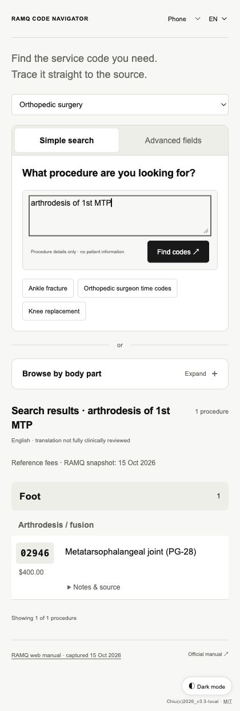
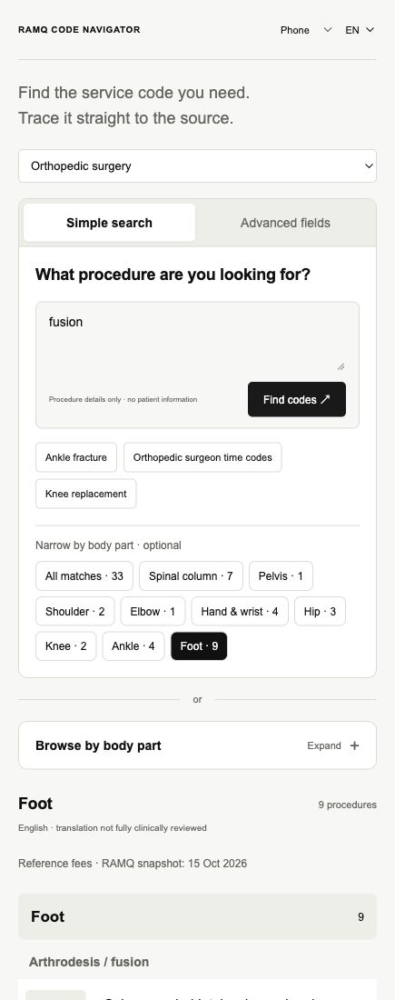
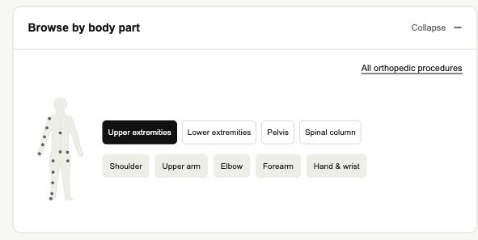
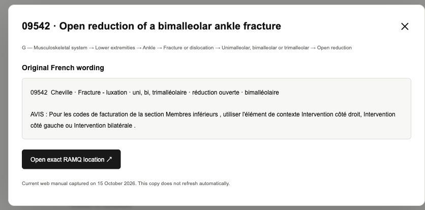

# RAMQ Code Navigator

**Find a service code. Browse the manual. Open its source.**

### [Open RAMQ Code Navigator ↗](https://larichiu.github.io/ramq-code-navigator/)

Created by **L. Chiu**. An independent interface for exploring codes in RAMQ’s specialist fee-for-service manual, with orthopedic shortcuts and access to the other indexed specialty headings. It works in a browser on a phone, tablet or computer; no installation or account is needed to use the website.

## Search for a procedure

Type a procedure, body part, supported abbreviation or five-digit code, then select **Find codes** or press Enter.

Examples: `arthrodesis of 1st MTP`, `IP fusion`, `laminectomy`, `hallux valgus without osteotomy`, `ankle fracture`, `bimalleolar ankle ORIF`, `ORIF distal radius`, `TKA`, `THA`, `RTSA` or `carpal tunnel release`.

Results are grouped under anatomical and procedure headings in manual order. Each result puts the **code and procedure description** first, with a small grey reference fee beneath the code. All matching entries are available by scrolling; there is no “Show more” button. Click the code to copy it. Different techniques, revisions and supplements may appear as separate candidates.

Search recognizes a defined set of English/French terms and abbreviations. It does not understand every colloquial name or learn new terms automatically. If a phrase finds nothing, try the anatomical browser, advanced fields or the official code. “Without osteotomy” matches only entries explicitly stating that exclusion. Other negative qualifiers and contradictory procedure/code information ask for clarification. A combined procedure description is not automatically converted into a billable code combination. Laminectomy results can include discectomy entries that mention it; these procedures are not interchangeable.

## Browse by body part

Select **Browse by body part** to expand the anatomical browser. It starts collapsed to keep the search area clear. Select a region, then a named body part or a point on the diagram. **Pelvis** and **Spinal column** are separate options.

Select the heading again to collapse it. When a search is active, choosing a body part narrows that search instead of clearing it. For broad searches such as `fusion`, optional body-part buttons also appear beneath the search box. Without a search, the anatomical browser opens the full section.

## Use advanced fields

Choose **Advanced fields** and select a manual section. Each selection reveals the next level in the indexed RAMQ hierarchy. Continue through the available region, body part, category and subtype fields, then choose a specific procedure. Use **Reset fields** to start again.

Orthopedics appears first in the specialty selector. Choose another indexed specialty, or **All specialties** for a broader search. The filters follow the manual’s headings, so a shared procedure may be classified outside the specialty you expect.

## Read notes and check the source

Expand **Notes & source** beneath a result to view the manual path, conditions and original French wording. Select **Source** for the source popup, or the RAMQ link to open the indexed source location.

## Find orthopedic surgeon time codes

Select **Orthopedic surgeon time codes**, choose the relevant surgery family and enter hours/minutes of **total anesthesia duration**. Leave the duration empty to see all bands.

These are surgeon code families with eligibility conditions, not a general conversion of anesthesia units into minutes. Read the family’s linked conditions; duration alone does not determine eligibility. Pediatric and program-specific restrictions apply to some codes.

## Language, appearance and layout

Use **EN / FR** to change language, **Phone / Tablet / Desktop** to choose the layout, and the bottom-right control to switch light/dark mode. These preferences are saved in your browser.

## Bilingual anatomical terminology

Select **EN/FR anatomy glossary** at the bottom of the page to search a 28-entry bilingual glossary with medical terminology reference links to OQLF/GDT and TERMIUM Plus. References for matching anatomical terms are also available within **Notes & source**.

All 15 named MSK body-part navigation labels have been checked against dictionary entries. Version 3.3.1 corrects 57 anatomical translation strings, including **sous-astragalienne → subtalar**, **cubitus → ulna**, **astragale → talus**, and **péroné → fibula**. Foot navicular terminology is kept distinct from wrist scaphoid terminology. The original French RAMQ wording remains intact. The anatomy glossary is a locally stored reference layer, not a live translation API, a full clinical review, or a billing-code crosswalk.

[Download the bilingual glossary (CSV)](anatomy-glossary.csv) · [Terminology check and corrections](terminology-audit.json)

## Current limits

**Version 3.3.1 · manual snapshot: October 15, 2026.**

This is a navigation prototype, not an official RAMQ application or a validated autonomous billing-code selector. The data does not refresh automatically. Known vocabulary gaps, imported hierarchy errors and unreviewed translations remain. English medical descriptions and conditions are **not fully clinically reviewed**; consult the original RAMQ source when meaning or eligibility is uncertain.

Version 3.3 corrects 10 foot/spine heading paths. A comparison with the saved source range retains 76 foot rows and 101 spinal-column rows; all 5,679 catalogue entries remain available. See [the source comparison](data-audit.json). This is not a full clinical validation of the catalogue. DeepL and adaptive learning are not connected.

[Download the self-contained v3.3.1 HTML](RAMQ_Navigator_v3.3.1.html) for a copy that runs without a server.

No claims are submitted by this application. Search runs in your browser; do not enter patient names, identifiers or confidential clinical details.

See the [audit and improvement plan](AUDIT_AND_LEARNING_PLAN.md) for specific known failures. To report an issue, use [GitHub Issues](https://github.com/larichiu/ramq-code-navigator/issues) and include the generic search phrase, relevant code and source reference—without patient information.

## Credit and licence

Originally created by **L. Chiu**. Copyright (c) 2026 Chiu. The original software is available under the [MIT License](LICENCE.txt), permitting free use and further development while preserving the copyright and licence notices. RAMQ source material retains its own rights and terms; no RAMQ endorsement is claimed.

Maintainers can find publishing and development instructions in [PUBLISHING.md](PUBLISHING.md).
